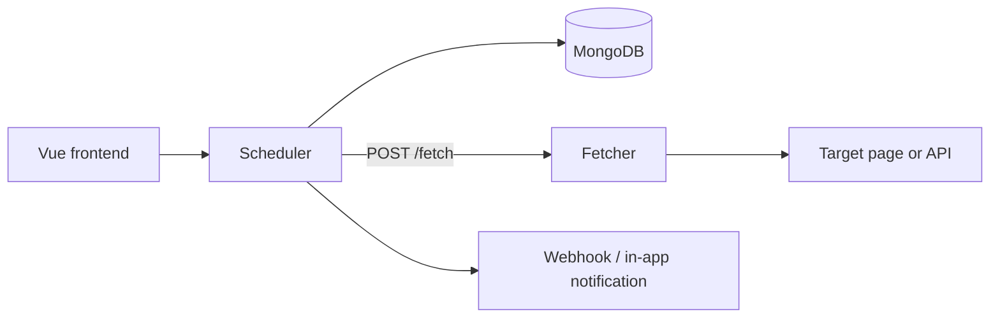

# StarWatch

[中文](./README.md)

**[Project site](https://stardreamtech.github.io/projects/starwatch/)**

StarWatch is a monitoring platform you can host yourself. Use a standard five-field cron expression, or an interval such as `every 30s`, `every 1 minute`, or `每 2 分钟`, to decide when to check a page or an API. The scheduler only handles time and storage. A stateless fetcher sends the actual request.

It watches the fields you name, not a hash of the whole page. Page-change checks, API assertions, and short load tests are the three built-in task types. A 403, a 429, a CAPTCHA, an empty body, an empty extraction, and a timeout are first-class results. They are not quietly stored as "no change".

## Architecture



- The **scheduler** stores tasks, claims due tasks by cron, calls the fetcher, and writes run records, snapshots, and notifications to MongoDB. It does not fetch pages itself.
- The **fetcher** has no database. `POST /fetch` sends the request with the requester and proxy chosen for the task, and returns the status, duration, response headers, body, and error type. A load-test batch runs here too.
- The **frontend** covers tasks, run history, diffs, notifications, and the plugin catalog. During development, `/api` is proxied to the scheduler. In a container, Nginx reverse-proxies it.

The scheduler is designed as a single replica. Claiming a task is an atomic update, but run only one scheduler so the same task is not triggered twice.

The fetcher calls any `http` or `https` address you enter. Keep it on a separate network, and do not let it reach internal admin interfaces.

## Start with Docker Compose

You need Docker, and access to pull `mongo:9.0.4`, `python:3.15-slim`, `node:22-alpine`, and `nginx:1.28-alpine`.

```bash
docker compose up --build
```

| Service | Address |
| --- | --- |
| Frontend | http://localhost:5173 |
| Scheduler | http://localhost:8080 |
| Fetcher | http://localhost:8081 |
| MongoDB | localhost:27017 |

Open the frontend, create a page monitor, save it, then click Run now. The result appears in the run history. When the schedule is due, the scheduler triggers the task itself.

A content monitor is configured step by step: schedule, request, detection target, extraction, version comparison, and notification. The target can be HTML, JSON, or plain text. For HTML, the `markdown` extractor and a CSS element selector (such as `body` or `article`) turn the selected region into Markdown, keep headings, lists, images, and links, and resolve relative URLs against the final page address. For JSON, a JSONPath of `$` watches the whole response, or you can select specific fields.

Every successful extraction stays in the run history. On the run detail page you can choose the before and after versions, and load older records. The line-by-line diff uses green for additions, red for deletions, and yellow for modifications. Automatic comparison and notification can each be turned off. Turning automatic comparison off still saves the content for a manual comparison.

All configuration comes from environment variables. See [`.env.example`](.env.example). The Compose file already contains the addresses the containers use to reach each other. Do not put secrets in the repository.

## Local development

Python 3.15 and [uv](https://docs.astral.sh/uv/):

```bash
uv sync
uv run --package starwatch-fetcher starwatch-fetcher
```

Start the scheduler in another terminal. Without MongoDB you can try the in-memory store. Its data is gone after a restart:

```bash
REPOSITORY_BACKEND=memory uv run --package starwatch-scheduler starwatch-scheduler
```

For real data, leave `REPOSITORY_BACKEND` as `mongo` and start MongoDB 9 first.

The frontend uses Node.js 22:

```bash
cd frontend
npm ci
npm run dev
```

The dev server listens at http://localhost:5173 and forwards `/api` to `STARWATCH_API_PROXY` (default `http://127.0.0.1:8080`).

Checks:

```bash
uv run ruff check .
uv run ruff format --check .
uv run mypy
uv run pytest
cd frontend && npm run lint && npm run typecheck && npm run build
```

## Add a requester or a proxy

A slot is a protocol plus a registry. Built-ins register first. If an entry point shipped in an installed package uses a name that already exists, it does not replace built-in names such as `httpx` or `direct`.

A requester implements `execute(spec, proxy)` and provides `name`, `description`, and `implemented`. A proxy also implements `validate(params)` and `resolve(params)`. `implemented = False` can reserve the name first: the task can be saved, and a run fails with a clear error instead of pretending to succeed.

In your own package:

```python
from starwatch_core.classify import ProxyChoice, RawExchange
from starwatch_core.schemas import RequestSpec


class MineRequester:
    name = "mine"
    description = "我的请求器。"
    implemented = True

    async def execute(self, spec: RequestSpec, proxy: ProxyChoice) -> RawExchange: ...


def build_mine() -> MineRequester:
    return MineRequester()
```

Register the entry point in that package's `pyproject.toml`:

```toml
[project.entry-points."starwatch.requesters"]
mine = "my_package.requester:build_mine"

[project.entry-points."starwatch.proxies"]
mine-pool = "my_package.proxy:build_mine_pool"
```

Install the package into the scheduler and fetcher environments. Both read entry points on startup. In a task, select `mine` as the requester or proxy name.

Proxy parameters:

| Provider | Parameters |
| --- | --- |
| `direct` | none |
| `static` | `url`, one of `http`, `https`, or `socks5` |
| `rotating` | `urls`, an array of proxy URLs, rotated inside the process |
| `pool_api` | stub. The convention is that `GET {endpoint}` returns `{"proxy": "http://ip:port"}` |

An external proxy pool currently keeps only this slot. When you connect your own pool, implement `ProxyProvider.resolve`. Do not fall back to a direct connection while it is unimplemented.

The extractor entry-point group is `starwatch.extractors`, notifications use `starwatch.notifiers`, and task types use `starwatch.task_handlers`.

## Task results

| Result | Meaning |
| --- | --- |
| `baseline` | The first successful extraction for a page monitor. It only stores a snapshot |
| `changed` / `unchanged` | Compared with the previous successful snapshot |
| `success` | An API check passed, or every load-test request succeeded |
| `failure` | An assertion failed, the server returned an error, or the load-test results were mixed |
| `blocked` | 403, 429, or a CAPTCHA |
| `empty` | The body is empty, or the extraction is empty. The snapshot is not replaced |
| `timeout` | Timed out |

In-app notifications are written for change, failure, and block. Whether the webhook was delivered is recorded separately. A delivery failure does not roll back the run. Email notification is still a stub.

Playwright, curl_cffi, and DrissionPage are stubs as well, so a browser requester can be added later. The requester available now is httpx.

## License

MIT. See [LICENSE](LICENSE).
