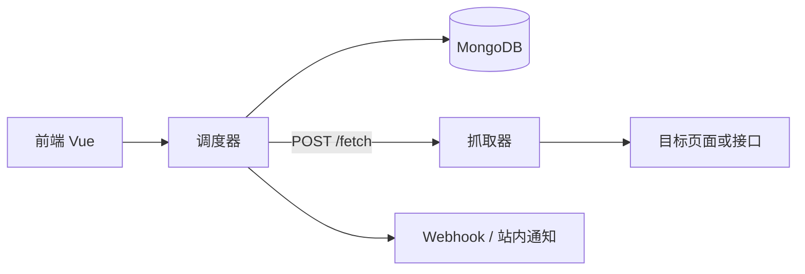

# 星哨 StarWatch

星哨是一个可以自己托管的定时监控平台。你用标准的五段 cron，或者 `every 30s`、`every 1 minute`、`每 2 分钟` 这样的间隔，定义什么时候去看一个页面或接口。调度器只负责时间和存储；真正发请求的是无状态的抓取器。

它盯住的是你指定的字段，不是整页哈希。页面变化、接口断言和短时压测是三种内置任务。403、429、验证码、空正文、空提取和超时都是一等结果，不会被悄悄写成「没有变化」。

## 架构



- **调度器**保存任务、按 cron 领取到期任务、调用抓取器，并把运行记录、快照和通知写入 MongoDB。它自己不抓页面。
- **抓取器**没有数据库。`POST /fetch` 按任务选择的请求器和代理发请求，返回状态、耗时、响应头、正文和错误类型。压测的那一批请求也在这里执行。
- **前端**负责任务、运行记录、差异、通知和插件目录。开发时把 `/api` 代理到调度器；容器里由 Nginx 反代。

调度器按单副本设计。领取任务使用原子更新，但请只运行一个调度器，避免重复触发。

抓取器会访问你填写的任意 `http`/`https` 地址。请把它放在单独的网络里，不要让它能碰到内网管理接口。

## 用 Docker Compose 启动

需要 Docker，以及能拉取 `mongo:9.0.4`、`python:3.15-slim`、`node:22-alpine` 和 `nginx:1.28-alpine`。

```bash
docker compose up --build
```

| 服务 | 地址 |
| --- | --- |
| 前端 | http://localhost:5173 |
| 调度器 | http://localhost:8080 |
| 抓取器 | http://localhost:8081 |
| MongoDB | localhost:27017 |

打开前端，新建一个网页监控，保存后可以点「立即运行」。结果会出现在运行记录里。到了调度时间，调度器也会自己触发。

配置都来自环境变量，示例见 [`.env.example`](.env.example)。Compose 文件里已经写好容器之间的地址。不要把密钥写进仓库。

## 本地开发

Python 3.15 和 [uv](https://docs.astral.sh/uv/)：

```bash
uv sync
uv run --package starwatch-fetcher starwatch-fetcher
```

另一个终端启动调度器。没有 MongoDB 时可以用内存存储做试验，重启后数据会消失：

```bash
REPOSITORY_BACKEND=memory uv run --package starwatch-scheduler starwatch-scheduler
```

正式数据请把 `REPOSITORY_BACKEND` 留为 `mongo`，并先启动 MongoDB 9。

前端使用 Node.js 22：

```bash
cd frontend
npm ci
npm run dev
```

开发服务器在 http://localhost:5173 ，并把 `/api` 转到 `STARWATCH_API_PROXY`（默认 `http://127.0.0.1:8080`）。

检查：

```bash
uv run ruff check .
uv run ruff format --check .
uv run mypy
uv run pytest
cd frontend && npm run lint && npm run typecheck && npm run build
```

## 怎么加一个请求器或代理

槽位是协议加注册表。内置实现先注册；安装包里的入口点如果名字已经存在，不会覆盖 `httpx`、`direct` 这些内置名字。

请求器实现 `execute(spec, proxy)`，并提供 `name`、`description`、`implemented`。代理还要实现 `validate(params)` 和 `resolve(params)`。`implemented = False` 可以先占住名字：任务能保存，运行时会明确失败，而不是假装成功。

在你自己的包里：

```python
from starwatch_core.classify import ProxyChoice, RawExchange
from starwatch_core.schemas import RequestSpec


class MineRequester:
    name = "mine"
    description = "我的请求器。"
    implemented = True

    async def execute(self, spec: RequestSpec, proxy: ProxyChoice) -> RawExchange: ...


def build_mine() -> MineRequester:
    return MineRequester()
```

然后在该包的 `pyproject.toml` 注册入口点：

```toml
[project.entry-points."starwatch.requesters"]
mine = "my_package.requester:build_mine"

[project.entry-points."starwatch.proxies"]
mine-pool = "my_package.proxy:build_mine_pool"
```

把包安装进调度器和抓取器的环境。两边启动时都会读取入口点。任务里把请求器或代理的名字选成 `mine` 即可。

代理参数约定：

| 提供者 | 参数 |
| --- | --- |
| `direct` | 无 |
| `static` | `url`，支持 `http`、`https`、`socks5` |
| `rotating` | `urls`，代理 URL 数组，进程内轮询 |
| `pool_api` | 存根。约定 `GET {endpoint}` 返回 `{"proxy": "http://ip:port"}` |

外部代理池目前只保留这个槽位。接入你自己的池时实现 `ProxyProvider.resolve`，不要在未实现时退回直连。

提取器入口组是 `starwatch.extractors`，通知是 `starwatch.notifiers`，任务类型是 `starwatch.task_handlers`。

## 任务结果

| 结果 | 含义 |
| --- | --- |
| `baseline` | 网页监控第一次成功提取，只建立快照 |
| `changed` / `unchanged` | 和上一份成功快照相比 |
| `success` | 接口探活通过，或压测全部成功 |
| `failure` | 断言失败、服务端错误，或压测结果混合 |
| `blocked` | 403、429 或验证码 |
| `empty` | 正文为空，或提取结果为空。快照不会被替换 |
| `timeout` | 超时 |

站内通知在「变化 / 失败 / 拦截」时写入。Webhook 是否送达另记一笔，失败不会回滚这次运行。邮件通知仍是存根。

Playwright、curl_cffi 和 DrissionPage 也是存根，方便以后换成浏览器请求。当前可用的请求器是 httpx。

## 许可

MIT，见 [LICENSE](LICENSE)。
